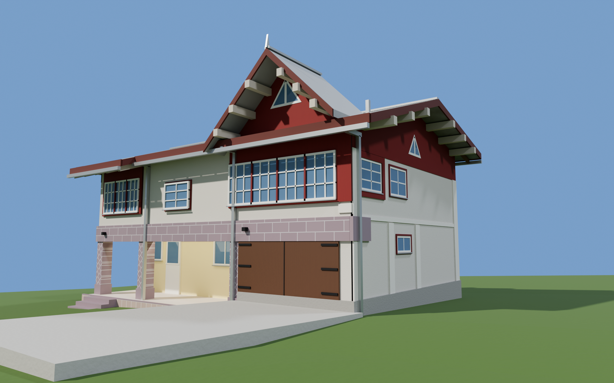
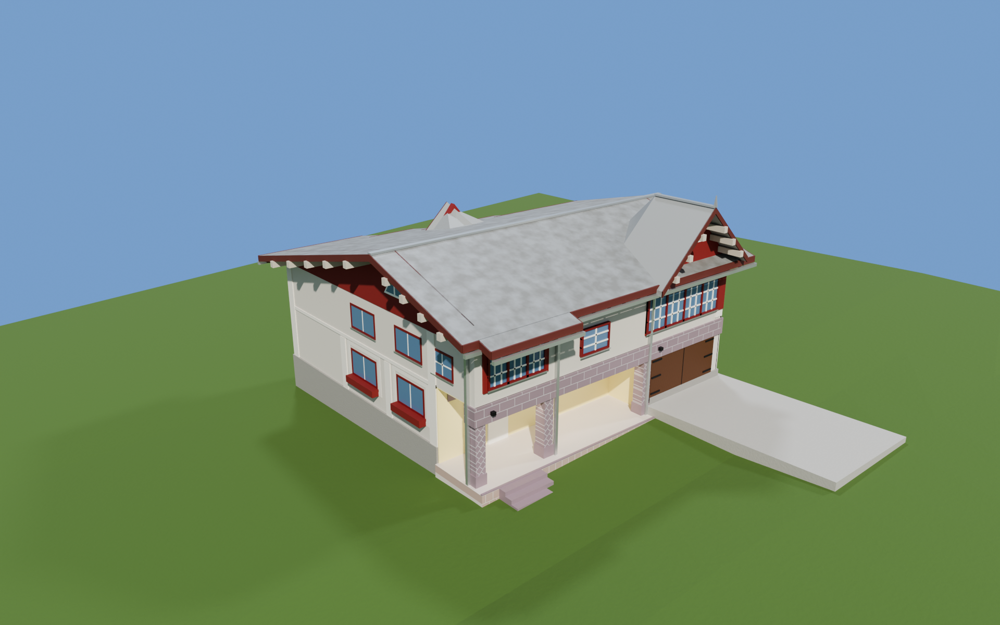
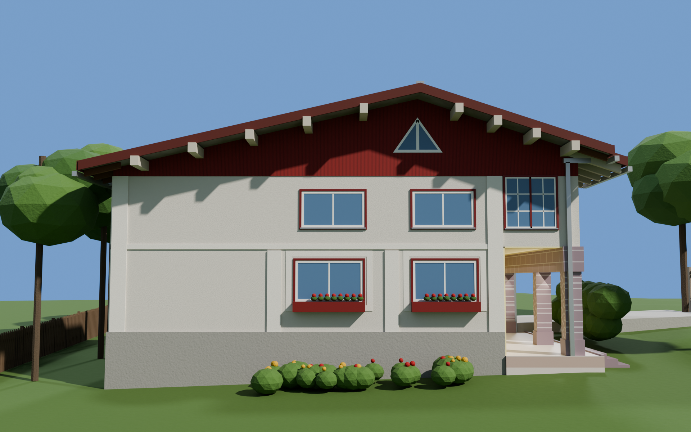
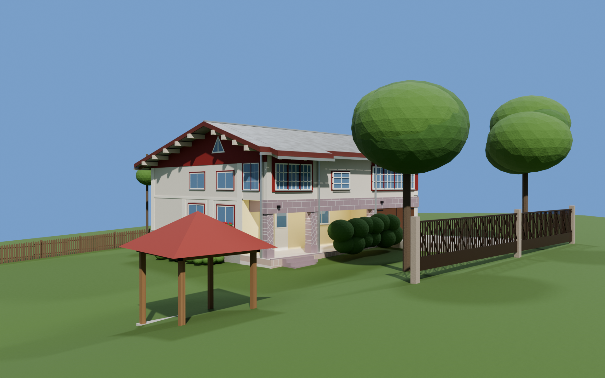

# Parametric 3D House Generator

A Python script that rebuilds a real two-storey house in 3D from its architectural drawings and photos, using the **Blender Python API (`bpy`)**. Nothing is modelled by hand: every wall, window, roof plane, fence post and tree is generated from code, and the whole scene is rebuilt from a single set of dimensions in seconds.

| | |
|---|---|
|  |  |
|  |  |

## Why

Manual modelling from photos produced a house that looked roughly right but was never accurate. The original 1992 drawings contained exact dimensions, so I turned the problem into code: dimensions live in one place, and the geometry is derived from them. Fixing a mistake means changing a number and re-running the script, not redoing the model.

## What it generates

- **1,000+ objects** from ~800 lines of Python and **37 functions**: walls, stepped façade, gable roofs, dormers, columns, 20+ windows with frames and glazing bars, gutters, downpipes, a gate, fences, a well, a gazebo and vegetation.
- **Meshes built from raw vertex and face data** (`from_pydata`): boxes, extruded polygon prisms and thickened roof slabs, rather than operator calls.
- **Procedural materials** made of shader nodes: stucco bump, vertical timber boarding, tiled cladding, weathered sheet metal.
- Lighting, camera and render settings, ready for **Cycles** GPU rendering.

## How it works

**Data-driven geometry.** The back of the house steps down in three stages. Instead of hard-coding each wall, the script keeps one list:

```python
SEG = [(0.00, 3.30, 12.20), (3.30, 4.90, 10.60), (4.90, 8.20, 9.10), (8.20, W, 8.40)]
```

Each entry is turned into a wall, roof strip, gutter and downpipe by the same loops.

**Maths for the roof and terrain.** The roof is asymmetric: the ridge sits 4.2 m from the front, with a different pitch on each side. Its height at any depth `y` is a piecewise function, and the pitch itself was derived from the drawings' level marks and cross-checked against the declared 32 %. The sloped plot is a function of position too, so the fence and terrace follow the ground.

**Reusable building blocks.** `window()`, `gable_roof()`, `gard_uluci()` (fence), `copac()` (tree) and others take parameters with sensible defaults. Changing every window frame in the house meant editing one function.

**Idempotent.** The script clears the scene first, so running it twice gives the same result.

**Colour management.** Colours sampled from photographs are converted from sRGB to linear, which made the materials match the reference instead of looking washed out.

## Run it

1. Install [Blender](https://www.blender.org/) (developed on 5.2).
2. Open the **Scripting** workspace, open `house_generator.py`, press **Run Script**.
3. Switch the viewport to Material Preview, or render with `F12`.

> Some variable and function names are in Romanian, as it was written for the house's own owners.

## Tech

Python · Blender Python API (`bpy`) · Cycles · procedural geometry · 3D maths (vectors, trigonometry, piecewise functions)
